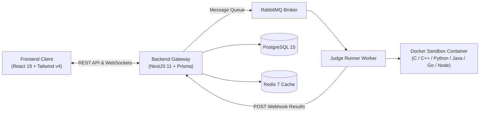

# ⚡ JudgeHub - Online Judge & Learning Platform

<p align="center">
  <strong>Nền tảng Online Judge & Quản lý Đào tạo Lập trình Trực tuyến Hiện đại</strong><br>
  Tích hợp Sandbox Container an toàn, Trợ lý Sư phạm AI, Real-time WebSockets và Chống gian lận kỳ thi.
</p>

<p align="center">
  
  
  
  
  
  
  
</p>

---

## 🌟 Điểm nổi bật (Key Features)

- 💻 **Trình giải bài trực tuyến:** Bộ soạn thảo code đa tính năng hỗ trợ 6 ngôn ngữ (**C, C++, Python, Java, Go, Node.js**), chế độ chạy thử với Custom Input và cơ chế bảo mật che giấu Testcase ẩn.
- 🎓 **Cổng Sinh viên (Student Portal):** Hệ thống xếp hạng ELO, chuỗi Streak học tập, biểu đồ Activity Heatmap 365 ngày (dạng GitHub), tham gia lớp học qua Invite Code và làm bài tập theo kỳ hạn.
- 👨‍🏫 **Cổng Giảng viên (Instructor Portal):** Quản trị kho đề thi (Markdown/LaTeX), quản lý lớp học & xuất sổ điểm CSV, giao bài tập về nhà và **chấm điểm mã nguồn thủ công kèm lời phê**.
- 🏆 **Đấu trường Kỳ thi & Anti-Cheat:** Bảng xếp hạng Live Leaderboard cập nhật tức thì qua WebSockets, tự động phát hiện chuyển tab (quy tắc 3 lần cảnh báo truất quyền thi) và công cụ **quét đạo văn mã nguồn (Winnowing Algorithm)**.
- 🤖 **Trợ lý Sư phạm AI:** Gợi ý độ phức tạp, bắt lỗi biên, định hướng tư duy giải thuật mà **không đưa code giải trực tiếp**, phân tích nguyên nhân lỗi nộp bài và tự động khóa AI trong giờ thi.
- 🛡️ **Sandbox Chấm bài Cách ly:** Microservice Judge Runner thực thi code trong Docker container cô lập (`cap_drop: ALL`, `network_mode: none`, `read_only: true`, giới hạn CPU/RAM/PIDs).

---

## 🏗️ Kiến trúc & Công nghệ (Tech Stack)



| Tầng | Công nghệ chính |
|---|---|
| **Frontend** | React 19, Vite 7, TypeScript, Tailwind CSS v4, TanStack Query v5, Socket.IO Client, Lucide Icons, React-Markdown. |
| **Backend** | NestJS 11, Prisma ORM 7 (`@prisma/adapter-pg`), Passport JWT & Google OAuth 2.0, Socket.IO Gateway, Nodemailer, Swagger. |
| **Hạ tầng & Queue** | PostgreSQL 15, Redis 7, RabbitMQ 3 (Management). |
| **Judge Engine** | Node.js, Dockerode, Docker Sandbox (`judgehub-sandbox` Ubuntu 22.04), Webhook Security (`x-judge-secret`). |

---

## ⚡ Khởi chạy Nhanh (Quick Start)

### Yêu cầu tiên quyết
- **Node.js 20+** & **npm 10+**
- **Docker Desktop** đang chạy (đã bật Linux Containers)

### 1. Clone & Cài đặt

```bash
git clone <repo-url> DATN
cd DATN

# Cài đặt dependencies cho cả 3 phân hệ
cd backend && npm install && npx prisma generate && cd ..
cd frontend && npm install && cd ..
cd judge-runner && npm install && cd ..
```

### 2. Thiết lập Biến môi trường

Sao chép các file mẫu `.env.example` thành `.env` (file `.env` thật đã được chặn trong `.gitignore`):

```bash
# Trên Linux/macOS
cp backend/.env.example backend/.env
cp frontend/.env.example frontend/.env

# Trên Windows PowerShell
Copy-Item backend/.env.example backend/.env
Copy-Item frontend/.env.example frontend/.env
```

### 3. Khởi động Cụm Hạ tầng & Database

```bash
# 1. Bật PostgreSQL, Redis, RabbitMQ
docker compose up -d postgres redis rabbitmq

# 2. Chạy migration cơ sở dữ liệu
cd backend
npx prisma migrate deploy

# 3. Nạp dữ liệu mẫu (Users, Class, Problems, Contest)
npm run seed:users
npm run seed:problems
cd ..
```

### 4. Build Sandbox Image cho Judge Runner

```bash
cd judge-runner
docker build -t judgehub-sandbox -f Dockerfile.sandbox .
cd ..
```

### 5. Chạy Ứng dụng (Mở 3 Terminal)

| Phân hệ | Lệnh thực thi | Địa chỉ truy cập |
|---|---|---|
| **Backend API** | `cd backend && npm run start:dev` | `http://localhost:3000` (Swagger: `/api/docs`) |
| **Frontend App**| `cd frontend && npm run dev` | `http://localhost:5173` |
| **Judge Runner**| `cd judge-runner && npm run dev` | `http://localhost:4000` |

> 💡 **Mẹo:** Bạn cũng có thể dựng toàn bộ hệ thống bằng 1 lệnh duy nhất qua Docker Compose: `docker compose up --build -d`.

---

## 🔑 Tài khoản Thử nghiệm Mẫu (Demo Accounts)

Sau khi chạy lệnh `npm run seed:users`, bạn có thể đăng nhập ngay với các tài khoản sau:

| Vai trò | Tài khoản (Email / Username) | Mật khẩu | Quyền hạn & Dữ liệu có sẵn |
|---|---|---|---|
| **Giảng viên** *(Instructor)* | `instructor@example.com` / `instructor` | `Password123@` | Quản trị lớp `CODE2026`, giao bài tập, chấm điểm thủ công, quản lý kỳ thi & soi đạo văn. |
| **Sinh viên** *(Student)* | `student@example.com` / `student` | `Password123@` | Đã tham gia lớp `CODE2026`, ELO 1250, streak 3 ngày, nộp bài & làm bài tập về nhà. |

> **Mã mời tham gia lớp học mẫu:** `CODE2026`

---

## 📂 Cấu trúc Thư mục (Repository Structure)

```text
DATN/
├── frontend/             # Giao diện người dùng SPA (React 19, Vite, Tailwind v4)
├── backend/              # RESTful API, Prisma ORM, Socket.IO & RabbitMQ Gateway (NestJS 11)
├── judge-runner/         # Dịch vụ Worker biên dịch và thực thi code trong Docker sandbox
├── docs/                 # Tài liệu đặc tả kỹ thuật chuyên sâu
│   └── TECHNICAL_REPORT.md  # Báo cáo kiến trúc, ERD, Sequence Diagrams & RBAC Matrix
├── docker-compose.yml    # File cấu hình điều phối toàn bộ cụm dịch vụ Docker
└── README.md             # Hướng dẫn tổng quan dự án
```

---

## 📚 Tài liệu Chi tiết & API Reference

- 📄 **Báo cáo Kỹ thuật & Đặc tả Kiến trúc:** Xem chi tiết sơ đồ ERD, Sequence Diagrams và Ma trận phân quyền RBAC tại [docs/TECHNICAL_REPORT.md](docs/TECHNICAL_REPORT.md).
- 📡 **Tài liệu API tương tác (Swagger UI):** Khởi động backend và truy cập `http://localhost:3000/api/docs`.
- 🐰 **RabbitMQ Management Dashboard:** `http://localhost:15672` (Tài khoản: `root` / `rootpassword`).

---

## 🛠️ Xử lý Sự cố Nhanh (FAQ)

<details>
<summary><b>1. Nộp bài bị treo vĩnh viễn ở trạng thái PENDING?</b></summary>
Kiểm tra xem <code>judge-runner</code> đã được bật chưa (<code>cd judge-runner && npm run dev</code>) và đảm bảo RabbitMQ container đang chạy (<code>docker compose ps rabbitmq</code>).
</details>

<details>
<summary><b>2. Judge Runner báo lỗi "Sandbox image judgehub-sandbox not found"?</b></summary>
Bạn chưa build image môi trường chấm. Chạy lệnh: <code>cd judge-runner && docker build -t judgehub-sandbox -f Dockerfile.sandbox .</code>
</details>

<details>
<summary><b>3. Backend không kết nối được PostgreSQL?</b></summary>
Lưu ý port PostgreSQL bên ngoài máy host là <b>5433</b> (được ánh xạ từ 5432 trong container). Kiểm tra <code>DATABASE_URL</code> trong <code>backend/.env</code> đã dùng đúng port 5433 chưa.
</details>

<details>
<summary><b>4. Prisma thiếu types hoặc models mới?</b></summary>
Chạy lệnh tạo lại Prisma Client: <code>cd backend && npx prisma generate</code>.
</details>

---

## 📄 License & Credits

Dự án Đồ Án Tốt Nghiệp (DATN) - Nền tảng JudgeHub.  
Phát triển bởi nhóm sinh viên thực hiện đồ án. Mọi đóng góp xin vui lòng tạo Pull Request hoặc Issue.
