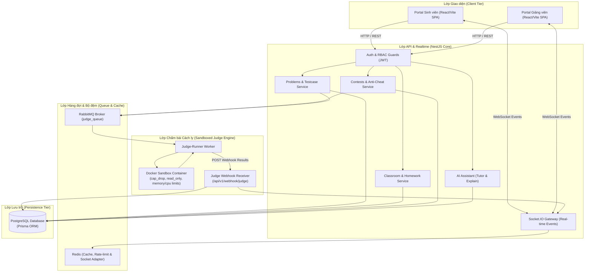
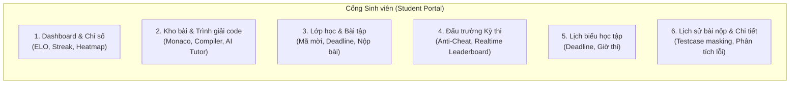
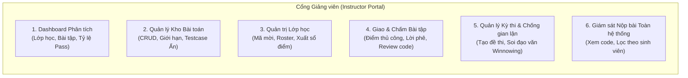
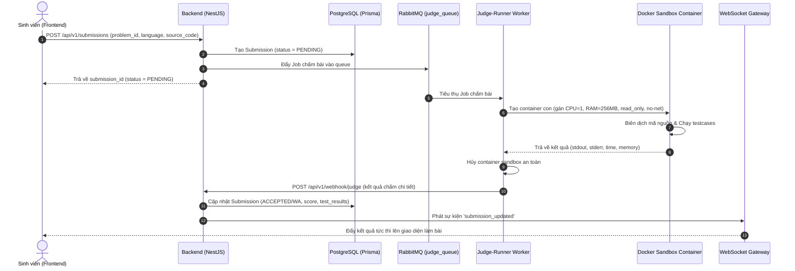
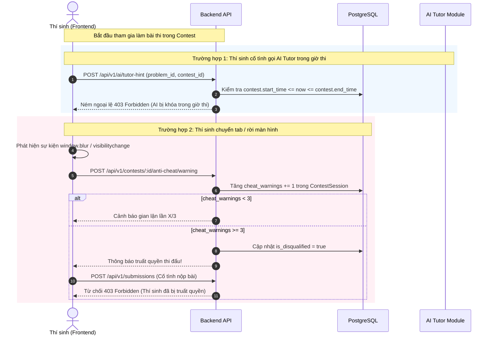
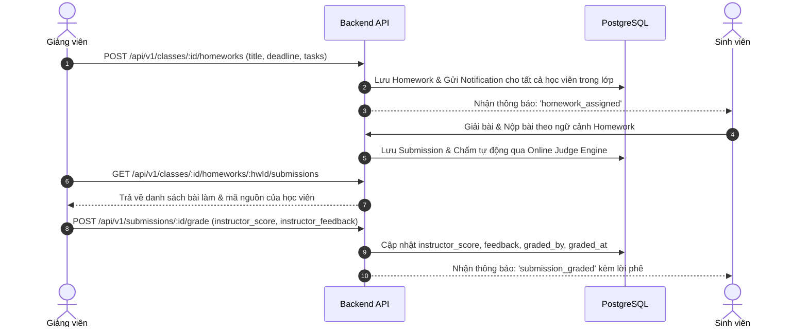

# BÁO CÁO KỸ THUẬT & ĐẶC TẢ TÍNH NĂNG HỆ THỐNG JUDGEHUB
## Phân hệ Người dùng: Sinh viên (Student) & Giảng viên (Instructor)

---

## 1. TỔNG QUAN KIẾN TRÚC HỆ THỐNG (SYSTEM ARCHITECTURE)

Hệ thống **JudgeHub** được thiết kế theo kiến trúc hướng dịch vụ module hóa (Modular Architecture), kết hợp giữa hệ thống RESTful API, Real-time WebSockets (Socket.IO), Message Queue không đồng bộ (RabbitMQ) và Sandbox Container cô lập (Docker) nhằm đảm bảo hiệu năng cao, bảo mật và khả năng mở rộng.



---

## 2. SƠ ĐỒ THỰC THỂ CƠ SỞ DỮ LIỆU (DATABASE ERD)

Dưới đây là lược đồ dữ liệu chi tiết phản ánh toàn bộ thực thể và quan hệ trong hệ thống thông qua Prisma ORM:

```mermaid
erDiagram
    User ||--o{ Submission : "submits"
    User ||--o{ Class : "administers"
    User ||--o{ ClassStudent : "enrolls"
    User ||--o{ ContestSession : "participates"
    User ||--o{ UserActivityLog : "records"
    User ||--o{ Notification : "receives"

    Problem ||--o{ TestCase : "has"
    Problem ||--o{ Submission : "evaluated_on"
    Problem ||--o{ ContestProblem : "included_in"
    Problem ||--o{ PlagiarismReport : "analyzed_in"

    Submission ||--o{ SubmissionTestResult : "produces"
    Submission ||--o{ PlagiarismReport : "submission_1"
    Submission ||--o{ PlagiarismReport : "submission_2"

    Class ||--o{ ClassStudent : "contains"
    Class ||--o{ Contest : "hosts"
    Class ||--o{ Homework : "assigns"

    Contest ||--o{ ContestProblem : "contains"
    Contest ||--o{ ContestSession : "tracks"
    Contest ||--o{ PlagiarismReport : "inspects"

    User {
        string id PK
        string email UK
        string username UK
        string password
        string full_name
        enum role "STUDENT | INSTRUCTOR"
        int elo_rating "Default: 1200"
        int current_streak
        int highest_streak
        json preferences
    }

    Problem {
        string id PK
        string title
        text description
        enum difficulty "EASY | MEDIUM | HARD"
        int time_limit "ms"
        int memory_limit "MB"
        string_array allowed_languages
    }

    TestCase {
        string id PK
        string problem_id FK
        text input
        text expected_output
        boolean is_hidden
    }

    Submission {
        string id PK
        string user_id FK
        string problem_id FK
        enum language "C | CPP | PYTHON | GO | JAVA | NODE"
        enum status "PENDING | IN_QUEUE | ACCEPTED | WRONG_ANSWER | TLE | CE | RTE"
        float score
        float instructor_score
        text instructor_feedback
        int execution_time
        int memory_used
    }

    SubmissionTestResult {
        string id PK
        string submission_id FK
        int testcase_index
        enum status
        int execution_time
        int memory_used
        text actual_output
    }

    Class {
        string id PK
        string name
        string semester
        string invite_code UK
        boolean is_public
        string admin_id FK
    }

    Homework {
        string id PK
        string title
        datetime deadline
        string class_id FK
        json tasks "Problem IDs & point weights"
    }

    Contest {
        string id PK
        string title
        datetime start_time
        datetime end_time
        boolean is_private
        boolean is_plagiarism_checked
        string class_id FK
    }

    ContestSession {
        string id PK
        string contest_id FK
        string student_id FK
        int cheat_warnings "Default: 0, Max: 3"
        boolean is_disqualified
    }

    PlagiarismReport {
        string id PK
        string contest_id FK
        string problem_id FK
        string submission_1_id FK
        string submission_2_id FK
        float similarity_score
    }
```

---

## 3. ĐẶC TẢ CHI TIẾT PHÂN HỆ SINH VIÊN (STUDENT PORTAL)

Sinh viên là đối tượng chính sử dụng nền tảng để luyện tập thuật toán, làm bài tập về nhà, tham gia các kỳ thi trực tuyến và nhận trợ giúp từ AI Tutor.



### 3.1. Dashboard & Hồ sơ cá nhân (Personal Profile & Gamification)
- **Hệ thống Xếp hạng ELO:** Điểm kỹ năng khởi tạo là `1200`. Điểm được tính toán và tăng/giảm linh hoạt dựa trên kết quả giải bài và thứ hạng trong kỳ thi.
- **Chuỗi học tập (Streak System):** Ghi nhận `current_streak` và `highest_streak`. Mỗi ngày có ít nhất 1 bài nộp thành công (`ACCEPTED`), chuỗi ngày học tập được tăng 1.
- **Activity Heatmap (Biểu đồ đóng góp dạng GitHub):** Hiển thị trực quan mật độ hoạt động giải bài trong 365 ngày qua bảng màu nhiệt dựa trên `UserActivityLog`.
- **Cấu hình Trình soạn thảo (User Preferences):** Tùy chỉnh `editorTheme` (`vs-dark`, `light`), `fontSize`, `tabSize` lưu trữ trực tiếp vào hồ sơ để áp dụng đồng bộ trên mọi thiết bị.

### 3.2. Kho bài tập & Trình soạn thảo trực tuyến (Monaco IDE & Problem Solver)
- **Danh sách bài tập:** Lọc đa tiêu chí theo độ khó (`EASY`, `MEDIUM`, `HARD`), trạng thái giải (`Chưa giải`, `Đã AC`, `Đang thử`), ngôn ngữ hỗ trợ.
- **Trình soạn thảo Code Monaco:** Hỗ trợ highlight cú pháp, auto-complete, format code cho 6 ngôn ngữ: **C, C++, Java, Python, Go, Node.js**.
- **Chế độ Chạy thử (Run with Custom Input):** Cho phép sinh viên nhập dữ liệu đầu vào tùy ý và chạy thử nghiệm mà không ghi nhận vào lịch sử nộp bài chính thức.
- **Quy tắc Bảo mật Testcase Bí mật (Testcase Masking Rule):**
  - Sinh viên **chỉ nhìn thấy** input/expected output của các testcase công khai (`is_hidden = false`).
  - Đối với testcase ẩn (`is_hidden = true`), hệ thống chỉ hiển thị trạng thái `[PASS / FAIL]`, thời gian chạy (ms), dung lượng bộ nhớ (MB). Toàn bộ dữ liệu `input` và `expected_output` bị **che dấu hoàn toàn** ở cấp độ Backend API để chống gian lận dò test.
- **Trợ lý AI Tutor hỗ trợ học tập (AI Pedagogical Assistant):**
  - **Chế độ COMPLEXITY:** Phân tích độ phức tạp thời gian và không gian tối ưu cho bài toán.
  - **Chế độ EDGE_CASE:** Gợi ý các trường hợp biên dễ bị sót (số âm, mảng rỗng, tràn số nguyên $2^{31}-1$).
  - **Chế độ EXPLAIN_LOGIC:** Hướng dẫn tư duy giải thuật mà **không đưa ra code trực tiếp** để đảm bảo tính giáo dục.
  - **Chế độ EXPLAIN_ERROR:** Phân tích nguyên nhân lỗi `WRONG_ANSWER` hoặc `TIME_LIMIT_EXCEEDED` dựa trên kết quả testcase thực tế.

### 3.3. Không gian Lớp học & Bài tập về nhà (Classroom & Homework)
- **Tham gia lớp học:**
  - Nhập mã mời 8 ký tự (`invite_code`) hoặc bấm vào đường link chia sẻ dạng `http://domain/join/CODE2026`.
  - Cơ chế RBAC chặn sinh viên truy cập bài tập của các lớp chưa tham gia (`403 Forbidden`).
- **Làm bài tập về nhà (Homework Assignment):**
  - Xem danh sách bài tập được giao kèm thời hạn chót (`deadline`) và đồng hồ đếm ngược.
  - Chuyển thẳng vào giao diện giải bài theo ngữ cảnh của bài tập (`/student/class/:classId/homework/:homeworkId/problem/:problemId`).
  - Xem điểm số giảng viên chấm thủ công (`instructor_score`) và lời phê chi tiết (`instructor_feedback`).

### 3.4. Đấu trường Kỳ thi & Cơ chế Chống gian lận (Contest Arena & Anti-Cheat)
- **Bảng xếp hạng Trực tiếp (Live Leaderboard):** Tự động cập nhật thứ hạng và điểm số tức thì qua WebSockets (`leaderboard_updated`) khi có thí sinh nộp bài.
- **Cơ chế Giám sát Chống gian lận (Anti-Cheat Engine):**
  - Lắng nghe sự kiện rời cửa sổ trình duyệt (`visibilitychange`, `window.blur`, thoát Fullscreen).
  - Tự động gửi cảnh báo lên server. Ghi nhận số lần cảnh báo `cheat_warnings` trong `ContestSession`.
  - **Quy tắc 3 Cảnh báo:** Nếu vi phạm đến lần thứ 3, hệ thống tự động gắn cờ `is_disqualified = true`, lập tức tước quyền thi và khóa quyền nộp bài (`403 Forbidden`).
- **Khóa AI trong Kỳ thi (Contest AI Lockdown):**
  - Trong thời gian kỳ thi đang diễn ra, mọi yêu cầu gọi trợ lý AI Tutor đều bị chặn đứng (`403 Forbidden`) để đảm bảo sự công bằng tuyệt đối.

### 3.5. Lịch biểu học tập & Lịch sử nộp bài (Calendar & Submissions)
- **Lịch biểu học tập (Interactive Calendar):** Hiển thị trực quan trên lịch tháng/tuần/ngày các mốc thời gian bắt đầu/kết thúc kỳ thi và hạn nộp bài tập.
- **Lịch sử nộp bài (Submission History):** Theo dõi trạng thái bài nộp thời gian thực (chuyển trạng thái từ `PENDING` -> `IN_QUEUE` -> `ACCEPTED`/`WRONG_ANSWER`), xem chi tiết kết quả từng testcase và xem lại mã nguồn đã nộp.

---

## 4. ĐẶC TẢ CHI TIẾT PHÂN HỆ GIẢNG VIÊN (INSTRUCTOR PORTAL)

Phân hệ Giảng viên cung cấp toàn bộ công cụ quản trị đào tạo, quản lý kho bài toán, quản lý lớp học, tổ chức kỳ thi, chấm điểm và giám sát học tập.



### 4.1. Dashboard Quản trị & Phân tích Đào tạo
- Thống kê tổng số lớp học đang phụ trách, số lượng sinh viên tham gia, số lượng bài toán trong ngân hàng đề.
- Biểu đồ phân bố trạng thái bài nộp (`ACCEPTED`, `WRONG_ANSWER`, `TLE`), giúp giảng viên nắm được mức độ khó của bài toán đối với sinh viên.

### 4.2. Quản lý Kho bài toán & Bộ Testcase (Problem & Testcase Management)
- **Tạo & Cập nhật Bài toán:**
  - Hỗ trợ định dạng đề bài bằng **Markdown** và công thức toán học **LaTeX**.
  - Thiết lập giới hạn thời gian chạy (`time_limit` tính theo ms) và giới hạn bộ nhớ (`memory_limit` tính theo MB).
  - Chọn danh sách ngôn ngữ lập trình cho phép (`allowed_languages`). Nếu để rỗng, hệ thống mở cho tất cả các ngôn ngữ.
- **Quản lý Bộ Testcase (Test Cases Bank):**
  - Thêm, sửa, xóa các cặp dữ liệu `input` và `expected_output`.
  - Phân loại rõ ràng: Testcase ví dụ minh họa (`is_hidden = false`) và Testcase bí mật để chấm điểm (`is_hidden = true`).
  - Hỗ trợ tải lên file testcase số lượng lớn (.txt, .zip).

### 4.3. Quản trị Lớp học & Học viên (Class & Roster Management)
- **Tạo & Quản lý Lớp học:** Tạo lớp mới với thông tin học kỳ (`semester`), mô tả môn học, tự động sinh mã mời duy nhất (`invite_code`).
- **Quản lý Danh sách Học viên (Student Roster):**
  - Xem danh sách học viên trong lớp kèm ngày tham gia.
  - Quyền xóa học viên khỏi lớp nếu sinh viên vào nhầm hoặc vi phạm nội quy.
- **Sổ điểm & Xuất Báo cáo (Gradebook & Export):**
  - Tổng hợp điểm số bài tập và kỳ thi của từng sinh viên trong lớp.
  - Xuất bảng điểm ra file định dạng Excel/CSV phục vụ báo cáo khoa/bộ môn.

### 4.4. Quản lý Bài tập về nhà & Chấm điểm Thủ công (Homework & Advanced Evaluation)
- **Tạo Bài tập về nhà:**
  - Chọn một hoặc nhiều bài toán từ Ngân hàng Đề bài để gán vào bài tập (`tasks`).
  - Thiết lập trọng số điểm cho từng bài và thời hạn chót nộp bài (`deadline`).
- **Chấm điểm & Đánh giá Nâng cao (Manual Grading & Feedback):**
  - Ngoài điểm tự động của hệ thống Online Judge (`score`), giảng viên có thể xem trực tiếp mã nguồn của sinh viên và chấm điểm phong cách lập trình (`instructor_score`).
  - Nhập lời nhận xét, góp ý chi tiết (`instructor_feedback`) lưu kèm thông tin người chấm (`graded_by`) và thời điểm chấm (`graded_at`).
  - Tự động bắn thông báo `submission_graded` đến tài khoản sinh viên.

### 4.5. Quản lý Kỳ thi & Phát hiện Đạo văn (Contest Management & Plagiarism Detection)
- **Tạo & Cấu hình Kỳ thi:**
  - Thiết lập thời gian bắt đầu (`start_time`), thời gian kết thúc (`end_time`).
  - Cấu hình phạm vi: Kỳ thi công khai toàn trường (`is_private = false`) hoặc Kỳ thi riêng tư cho lớp học cụ thể (`is_private = true` gắn với `class_id`).
- **Giám sát Vi phạm Trực tiếp:** Xem số lần cảnh báo gian lận (`cheat_warnings`) của từng thí sinh trong kỳ thi, danh sách thí sinh bị truất quyền thi (`is_disqualified`).
- **Công cụ Quét Đạo văn (Plagiarism Detection Engine):**
  - Sau khi kết thúc kỳ thi, giảng viên kích hoạt tính năng kiểm tra đạo văn.
  - Hệ thống sử dụng thuật toán phân tích cú pháp (Tokenization & Winnowing Fingerprint Algorithm) để so sánh từng cặp bài nộp của cùng một bài toán.
  - Sinh báo cáo `PlagiarismReport` hiển thị tỷ lệ tương đồng (`similarity_score`), bôi đỏ các đoạn mã nguồn giống nhau để giảng viên xử lý kỷ luật.

---

## 5. CÁC SƠ ĐỒ TUẦN TỰ NGHIỆP VỤ (SEQUENCE DIAGRAMS)

### 5.1. Luồng Chấm bài Tự động & Sandbox Cô lập (Judge Pipeline)



### 5.2. Luồng Kỳ thi & Cơ chế Chống Gian lận (Anti-Cheat & AI Lockdown)



### 5.3. Luồng Giao Bài tập, Sinh viên Nộp bài & Giảng viên Đánh giá Nâng cao



---

## 6. MA TRẬN PHÂN QUYỀN VAI TRÒ (RBAC MATRIX)

| Tính năng / Tài nguyên | Sinh viên (Student) | Giảng viên (Instructor) | Ghi chú bảo mật |
|---|:---:|:---:|---|
| **Đăng ký / Đăng nhập / Google Auth** | ✅ | ✅ | Cấp JWT Token theo Role |
| **Xem hồ sơ cá nhân / Streak / Heatmap** | ✅ | ✅ | Lưu trữ độc lập cho mỗi User |
| **Xem bài toán & Testcase công khai** | ✅ | ✅ | Sinh viên bị che testcase ẩn |
| **Xem Testcase bí mật (`is_hidden`)** | ❌ (Chặn 403) | ✅ | Đảm bảo tính trung thực chấm bài |
| **Tạo / Sửa / Xóa Bài toán & Testcase** | ❌ (Chặn 403) | ✅ | Quyền biên soạn bài tập |
| **Chạy thử nghiệm (Run code custom input)**| ✅ | ✅ | Chạy sandbox không lưu kết quả |
| **Nộp bài chính thức (Submit code)** | ✅ | ✅ | Đẩy vào hàng đợi RabbitMQ |
| **Sử dụng trợ lý AI Tutor khi luyện tập**| ✅ | ✅ | Hướng dẫn tư duy, không code hộ |
| **Sử dụng trợ lý AI trong kỳ thi trực tiếp**| ❌ (Khóa 403) | ✅ | Chống gian lận trong Contest |
| **Gia nhập lớp học bằng Invite Code** | ✅ | ❌ | Giảng viên quản lý lớp |
| **Tạo lớp học / Xóa lớp / Xóa học viên** | ❌ (Chặn 403) | ✅ | Quyền Admin lớp học |
| **Xem bảng điểm cả lớp / Xuất CSV** | ❌ (Chặn 403) | ✅ | Bảo vệ dữ liệu cá nhân học viên |
| **Tạo bài tập về nhà (Homework)** | ❌ (Chặn 403) | ✅ | Giao bài từ Ngân hàng đề |
| **Chấm điểm thủ công & Lời phê** | ❌ (Chặn 403) | ✅ | Ghi nhận `instructor_score` |
| **Tạo kỳ thi (Contest) & Đề thi** | ❌ (Chặn 403) | ✅ | Cấu hình thời gian, Private/Public |
| **Quét đạo văn bài thi (Plagiarism Check)**| ❌ (Chặn 403) | ✅ | So khớp mã nguồn Winnowing |

---

## 7. ĐẶC TẢ KỸ THUẬT MÔI TRƯỜNG SANDBOX & AN TOÀN HỆ THỐNG

1. **Docker Sandbox Isolation:**
   - Mã nguồn người dùng được biên dịch và thực thi trong container riêng biệt.
   - Tham số bảo mật:
     - `cap_drop: [ALL]`: Tước bỏ toàn bộ đặc quyền Linux root/kernel.
     - `network_mode: none`: Ngắt hoàn toàn kết nối Internet để chống gửi dữ liệu ra ngoài hoặc tấn công mạng.
     - `read_only: true`: Hệ thống tệp ở chế độ chỉ đọc, chỉ cho phép ghi dữ liệu tạm thời vào thư mục mount RAM `/tmp` giới hạn dung lượng.
     - `pids_limit: 64`: Chống tấn công Fork Bomb làm sập máy chủ.
     - `memory: 256m`: Giới hạn RAM tối đa, vượt quá sẽ bị `RUNTIME_ERROR (OOM)`.
2. **Xử lý Timeout & Infinite Loop:**
   - Worker giám sát tiến trình bằng cờ ngắt thời gian thực. Nếu thời gian thực thi vượt quá `time_limit` của bài toán, tiến trình bị ép dừng (`SIGKILL`) và trả về mã lỗi `TIME_LIMIT_EXCEEDED`.
3. **Che dấu Dữ liệu Nhạy cảm (Data Sanitization):**
   - Bộ lọc tầng Service loại bỏ toàn bộ dữ liệu testcase ẩn trước khi serialize JSON trả về cho Client của Sinh viên.

---

## 8. LỘ TRÌNH ĐỀ XUẤT PHÁT TRIỂN TIẾP THEO (FUTURE ROADMAP)

1. **Tích hợp LLM Đa phương thức:** Nâng cấp AI Tutor hỗ trợ phân tích hình ảnh/sơ đồ đồ thị và giải thích mã nguồn thời gian thực với streaming token qua WebSockets.
2. **Mở rộng Ngôn ngữ:** Bổ sung hỗ trợ Rust, Kotlin, Swift trong Sandbox Runner.
3. **Hệ thống Đấu giải 1v1 (Code Battle):** Cơ chế ghép cặp ngẫu nhiên theo ELO Rating thi đấu đối kháng trực tiếp tính thời gian giải bài.
4. **Phân tích Mã nguồn Động (Dynamic Code Analytics):** Trực quan hóa cấu trúc bộ nhớ và cây đệ quy của code sinh viên theo từng bước chạy (Visual Step Debugger).
